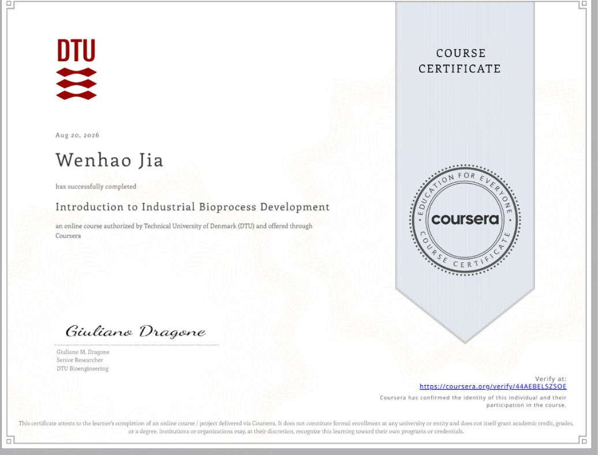
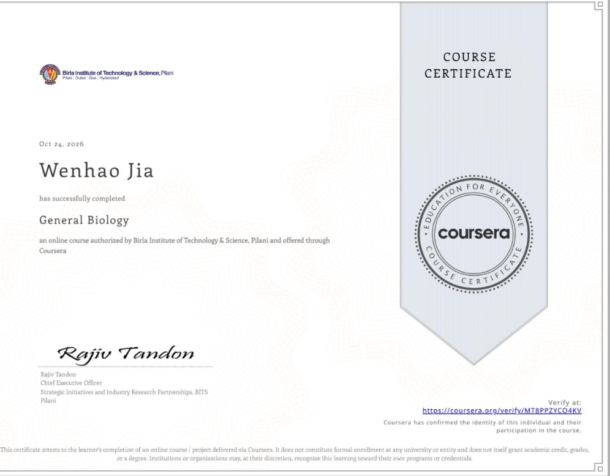

# Low-Cost Fermentation Monitoring for Schools

A proposal for monitoring batch fermentation in school labs, developed with a teammate and informed by my independent study of industrial bioprocessing.

**Third Prize · 2026 Youth AI Leadership Speech Challenge**

## From the course to the proposal

I completed the Technical University of Denmark's *Introduction to Industrial Bioprocess Development* course on Coursera on August 20, 2026. Studying batch, fed-batch, and continuous fermentation led me to ask which measurements a school lab could collect with simpler, less expensive equipment. [Course outline](https://www.coursera.org/learn/industrial-bioprocess-development) · [Course certificates](#course-certificates)

## What I proposed

I proposed logging readings from low-cost sensors over the course of a batch yeast fermentation. Students could compare trends across batches and look for changes worth investigating.

The pitch also explored how AI could make it easier for students to get started with sensor-based monitoring and learn to interpret their measurements.

## Monod model

I used the Monod equation to explain how the concentration of a limiting nutrient can affect the rate of yeast growth. [Monod's original paper](https://garcialab.berkeley.edu/courses/papers/Monod1949.pdf)

$$
\mu(S) = \mu_{\max}\frac{S}{K_s + S}
$$

- $\mu$ is the specific growth rate, and $\mu_{\max}$ is its maximum under the given conditions.
- $S$ is the concentration of the limiting substrate. At $S = K_s$, the growth rate is half of $\mu_{\max}$.

In a batch, the model predicts that growth slows as yeast uses up the limiting substrate. I proposed using sensor logs to compare how batches change over time. Estimating the model's parameters would require measurements or calibrated estimates of both substrate concentration and yeast growth.

## Contributions

I worked on the fermentation monitoring proposal, including the use of low-cost sensors and Monod kinetics. My teammate was responsible for the BioMarket portion of the presentation.

## Award

I received Third Prize at the 2026 Youth AI Leadership Speech Challenge on August 30, 2026. The certificate lists my name as **Vincent Wen** due to a name error. I use **Vincent** as my English given name and **Wenhao Jia** on my portfolio.

## Course certificates

### Introduction to Industrial Bioprocess Development

Technical University of Denmark (DTU)

- **Completed August 20, 2026** · [Verify on Coursera](https://www.coursera.org/verify/44AEBELSZSOE)
- **Estimated course workload** · 20 hours total · [Course page](https://www.coursera.org/learn/industrial-bioprocess-development)

### General Biology

BITS Pilani

- **Completed October 24, 2026** · [Verify on Coursera](https://www.coursera.org/verify/MT8PPZYCO4KV)
- **Estimated course workload** · 80 hours total · [Course page](https://www.coursera.org/learn/general-biology-odc)

[Back to my GitHub profile](https://github.com/jw3422951-ops)
