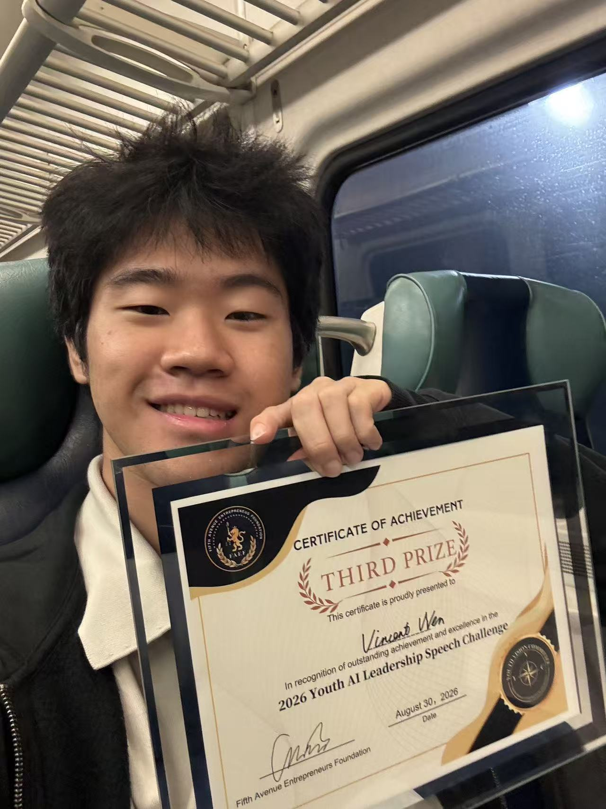

# Low-Cost Fermentation Monitoring Proposal for Schools

How could a school lab follow a batch of yeast fermentation with low-cost sensors? I developed the monitoring proposal and used the Monod model to explain the biology behind it. My teammate was responsible for the BioMarket portion of our presentation.

**Third Prize · 2026 Youth AI Leadership Speech Challenge**

[Monitoring proposal](#what-i-proposed) · [Monod model](#monod-model) · [Future research](#future-research) · [Award](#award)

## From the course to the proposal

I completed the Technical University of Denmark's *Introduction to Industrial Bioprocess Development* course on Coursera on August 20, 2026. I worked through the equations and concepts behind batch, fed-batch, and continuous fermentation. That led me to ask which measurements school labs could collect with low-cost sensors when they lack industrial monitoring equipment. [Course outline](https://www.coursera.org/learn/industrial-bioprocess-development)

## What I proposed

I proposed logging readings from low-cost sensors over the course of a batch yeast fermentation. Students could compare trends across batches and look for changes worth investigating.

The pitch also explored how AI could make it easier for students to get started with sensor-based monitoring and learn to interpret their measurements.

## Monod model

I used the Monod equation to explain how the concentration of a limiting nutrient can affect the rate of yeast growth. [Monod's original paper](https://garcialab.berkeley.edu/courses/papers/Monod1949.pdf)

$$
\mu(S) = \mu_{\max}\frac{S}{K_s + S}
$$

- $\mu$ is the specific growth rate, and $\mu_{\max}$ is its maximum under the given conditions.
- $S$ is the concentration of the limiting substrate. At $S = K_s$, the growth rate is half of $\mu_{\max}$.

In a batch, the model predicts that growth slows as yeast uses up the limiting substrate. I proposed using sensor logs to compare how batches change over time. Estimating the model's parameters would require measurements or calibrated estimates of both substrate concentration and yeast growth.

## Future research

I plan to use sensor readings to document when yeast fermentation departs from a baseline. By comparing batches under known conditions, I want to test whether different causes of unusual fermentation produce distinct, repeatable patterns in the readings.

## Award

I received Third Prize at the 2026 Youth AI Leadership Speech Challenge on August 30, 2026. The certificate lists my name as **Vincent Wen** due to a name error. I use **Vincent** as my English given name and **Wenhao Jia** on my portfolio.

[Back to my GitHub profile](https://github.com/jw3422951-ops)
